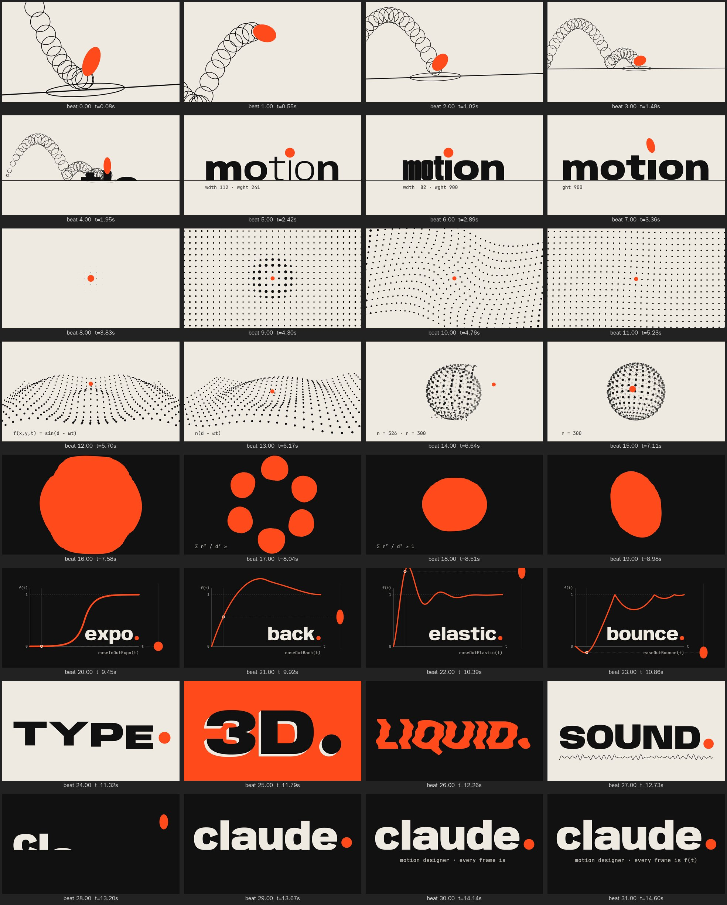

# Showreel 2026 — 15 s, all code

`showreel.mp4` · 1920×1080 · 60 fps · H.264 yuv420p CRF 16 · AAC 320k · −14 LUFS

One accent dot carries the whole reel: it starts as an animator's bouncing ball,
lands as the tittle of the **i**, seeds a dot grid, turns into a 3D terrain and a
sphere, gets drained as liquid into an ease curve, rides that curve, and ends as
the period of the name.



| bars | beats | scene | what it shows |
|---|---|---|---|
| 1 | 0–4 | Bounce | timing & spacing: onion-skin chart, squash & stretch, halving bounce rhythm |
| 2 | 4–8 | Type | variable-font kinetic type: weight wave, width accordion, anticipation |
| 3 | 8–12 | Grid | procedural field: wavefront spawn, ripple, swirl, tilt into 3D |
| 4 | 12–16 | 3D | radial wave terrain → lat/long sphere, orbiting dot, dive through |
| 5 | 16–20 | Liquid | metaballs (marching squares), splash, pour along a path |
| 6 | 20–24 | Curve | graph editor: expo / back / elastic / bounce. The score plays each curve as pitch |
| 7 | 24–28 | Slams | TYPE. 3D. LIQUID. SOUND. one treatment per beat |
| 8 | 28–32 | End card | the dot falls into the period, mirroring the opening bounce |

## How it is made

- **Picture**: `index.html` + `src/film.js`. `window.seek(t)` paints frame *t*.
  The output depends only on *t*: no transitions, timers, or carried state, and
  seeded noise only. Motion blur comes from 12 sub-frames over a 180° shutter,
  averaged in linear light.
- **Type**: Anybody (display, variable wdth 50–150 / wght 100–900) is baked into
  point-compatible outlines (`bake-glyphs.mjs` → `src/glyphs.js`) and
  interpolated per letter, per frame. JetBrains Mono is the UI face.
- **Sound**: `score.mjs` synthesizes everything: drums, bass, supersaw chords,
  an FM "dot voice", and SFX. Then a convolution reverb, a lookahead limiter,
  and BS.1770 loudness normalization to −14 LUFS.
- **Sync**: `src/cues.js` is the single cue sheet (in beats).
  `measure-beats.mjs` detects onsets in the rendered score and fits the grid →
  `beats.json`. The film times every hit from that measured grid.
  `sync-check.mjs` tracks the dot in the final video. Impacts land within
  14 ms of their beats, under one 60 fps frame.

## Rebuild

```sh
npm install            # fontkit + playwright (uses the preinstalled Chromium)
npm run all            # score → beats.json → render (≈2 min on 4 cores) → sync report
npm run sheet          # one frame per beat → out/sheet.png and out/sheet-phone.png
node render.mjs --at 2.4,9.6 --samples 12   # stills
```
